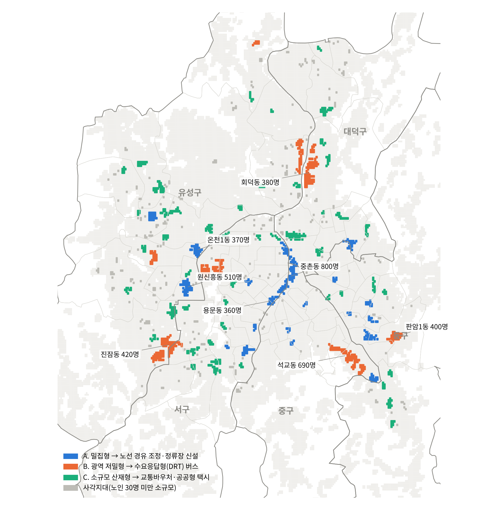
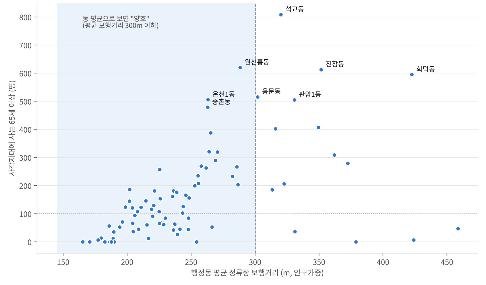
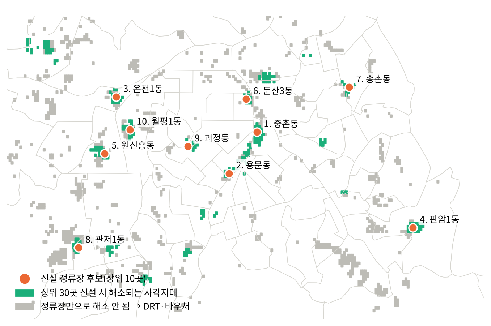

# 평균에 가려진 교통 사각지대 — 대전

> 대전을 100m 격자로 나눠 65세 이상 노인의 버스 접근성을 분석하고, 사각지대를 AI로 유형화한 뒤 정류장 신설 최적 위치를 계산한 프로젝트입니다.
>
> 「AI와 함께하는 교통문제 해결을 위한 데이터 분석 공모전」(숲과나눔·한겨레, 2026) 출품작 · 보고서: [`docs/이태희_분석보고서.pdf`](docs/이태희_분석보고서.pdf)



## 핵심 결과

| 지표 | 값 |
|---|---|
| 대전 65세 이상 인구 (주민등록 2026.9) | 288,572명 |
| 교통 사각지대에 사는 노인 | 약 14,000명 |
| 그중 **동 평균으로는 "양호"한 동**에 사는 비율 | **56%** (35개 동, 약 7,800명) |
| 사각지대 생활권 (AI 군집) | 79곳 — 밀집형 20 · 광역 저밀형 12 · 소규모 산재형 47 |
| 정류장 10곳 신설 시 해소 | 2,070명 (15%) |
| 정류장 30곳 신설 시 해소 | 4,103명 (29%) → 나머지는 DRT·바우처 필요 |

<p align="center">
  
  
</p>

## 분석 방법

1. **100m 격자 노인 인구**: WorldPop 연령별 격자를 행정동별 주민등록 65세 이상 인구에 맞게 비례 보정
2. **실제 보행 거리**: OpenStreetMap 보행 도로망에서 다익스트라 최단경로로 가장 가까운 정류장까지의 거리 계산
3. **버스 접근성 지수(SAI)**: 600m 안 정류장의 경유 노선 수 × 거리 감쇠 (런던 PTAL 단순화)
4. **사각지대**: 노인 3명 이상 격자 중 보행 500m 초과 또는 SAI 하위 20%
5. **평균 vs 격자**: 동 평균 보행거리 300m 이하인데 사각지대 노인이 100명 이상인 동 = "평균에 가려진 동"
6. **AI 유형 분류**: DBSCAN(150m)으로 생활권을 묶고 K-평균(k=3)으로 밀집형 / 광역 저밀형 / 소규모 산재형 분류
7. **정류장 입지 최적화**: 최대커버링 입지 문제(MCLP)를 탐욕 알고리즘으로 풀어 보행 400m 안 노인을 최대로 덮는 위치 선정
8. **탄소 감축 시나리오**: 자가용 통행의 전기 DRT 전환 가정

## 폴더 구조

```
daejeon-transit-blindspot/
├── README.md
├── run_all.py             # 전체 파이프라인 실행
├── config.py              # 폴더 경로 설정
├── requirements.txt
├── src/
│   ├── 00_boundary.py         # 행정동 경계
│   ├── 01_fetch_osm.py        # OSM 정류장·노선·시설·보행망 수집
│   ├── 02_fetch_worldpop.py   # WorldPop 연령별 격자 수집
│   ├── 03_build_osm.py        # 정류장·노선·시설 정리
│   ├── 04_build_walk.py       # 보행 네트워크 그래프
│   ├── 05_build_grid.py       # 100m 격자 + 접근성 지표
│   ├── 06_calibrate.py        # 주민등록 노인 인구로 보정
│   ├── 07_analyze.py          # 사각지대, DBSCAN·K-means
│   ├── 08_carbon.py           # 탄소 감축 시나리오
│   ├── 09_optimize_stops.py   # 정류장 신설 최적 입지(MCLP)
│   ├── 10_figures.py / 11_fig_mclp.py   # 그림
│   └── 12_fetch_tago_optional.py        # (선택) TAGO 배차간격 수집
├── data/
│   ├── raw/        # 원본 데이터 (git 제외, 받는 법은 data/raw/README.md)
│   └── processed/  # 가공 데이터 (자동 생성, git 제외)
├── results/        # 결과 표·요약·그림
└── docs/           # 제출 보고서
```

## 실행 방법

```bash
pip install -r requirements.txt
# 1) 주민등록 연령별 인구 CSV를 data/raw/에 넣기 (data/raw/README.md 참고)
# 2) 전체 실행 (OSM·WorldPop 자동 수집 포함, 약 10~20분)
python run_all.py
# 이미 data/raw에 원본이 있으면
python run_all.py --skip-fetch
```

결과는 `results/`에 저장됩니다: `summary.json`(핵심 수치), `admdong_blindspot.csv`(행정동별), `blind_pockets.csv`(사각지대 생활권), `new_stop_candidates.csv`(정류장 신설 후보), `figures/`(그림).

## 데이터 출처

| 데이터 | 제공 | 라이선스 |
|---|---|---|
| 연령별 인구현황 (행정동, 2026.9) | 행정안전부 주민등록 인구통계 | 공공누리 |
| 전국 대중교통 버스정류장 현황 (2024.12, 검증용) | 한국교통안전공단 · 공공데이터포털 | 공공누리 |
| 연령·성별 인구 100m 격자 R2025A | WorldPop | CC BY 4.0 |
| 버스정류장·노선·보행 도로망·생활시설 | © OpenStreetMap contributors | ODbL |
| 행정동 경계 (2026.7) | [vuski/admdongkor](https://github.com/vuski/admdongkor) | 저장소 라이선스 |

## 한계

- 동 안의 노인 위치는 WorldPop 추정을 따릅니다.
- 버스 배차간격과 경사는 반영하지 않았습니다 (`12_fetch_tago_optional.py`로 확장 가능).
- 탄소 감축은 가정 기반 시나리오입니다.

## AI 활용

데이터 수집 경로 탐색, 분석 코드 작성, 보고서 초안 작성에 Claude(Anthropic)를 활용했습니다. 결과 수치는 공식 통계(주민등록 인구 합계, 공식 정류장 수)와 대조해 검증했습니다.

## 라이선스

코드: MIT · 데이터: 각 출처 라이선스를 따릅니다.
